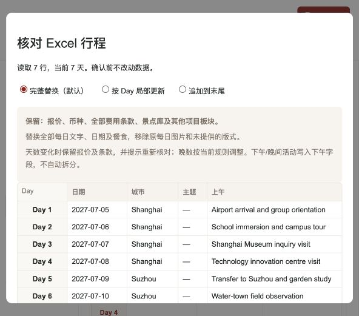

# Product walkthrough — 2026-11-25

## Scenario

In an isolated local browser with cloud storage disabled, I created a fictional seven-day Shanghai and Suzhou study tour for 20 students. I entered the brief, imported a nine-column Excel itinerary, created two test attraction resources and inserted them into the proposal, entered a GBP price and selected matching fee clauses, reviewed the eight-page proposal, and downloaded an A4 PDF. No production Supabase data was read or changed.

## Product experience finding

The Excel confirmation table showed 11 columns for a nine-column upload. The unused **主题** and **晚间** columns appeared before the imported afternoon activity, which made the review harder in a narrow workspace. This is a product experience issue, not an import-data error.

The preview now hides those two columns when every imported row leaves them blank and labels the afternoon field **下午/晚间活动**. If either field contains data in a future format, the preview shows it. The editable itinerary table and import mapping are unchanged.

| Before | After |
| --- | --- |
|  |  |

The review went from 11 to 9 columns. The number of clicks did not change; the improvement is less horizontal scanning. Reading time was not measured.

## Verification

- The test upload showed all seven days and their dates, cities, morning activities, combined afternoon activities, meals and notes.
- Confirming the import updated the itinerary to seven days and retained the explicit reminder to recheck quotation terms.
- The full proposal preview showed both attraction cards, itinerary pages, GBP 2,500 and only the selected fee clauses.
- The downloaded PDF had eight A4 pages. This walkthrough did not verify real images or a populated course-template library because the isolated test browser had neither.
- TypeScript check: passed. Automated tests: 60 passed, 0 failed. Production build: passed. Vite reported the existing large-chunk warning.

## Next product questions

- **Product experience:** In the main itinerary editor, an empty theme column still occupies width. Evaluate a reversible show/hide control without hiding existing theme content.
- **Product experience:** Resource selection follows library order, so the two selected attractions needed one manual reorder step to match the itinerary.
- **Technical/product:** Verify cloud synchronization with team test accounts in a separate safe exercise; this isolated browser deliberately had no cloud connection.
